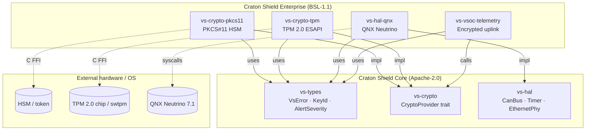
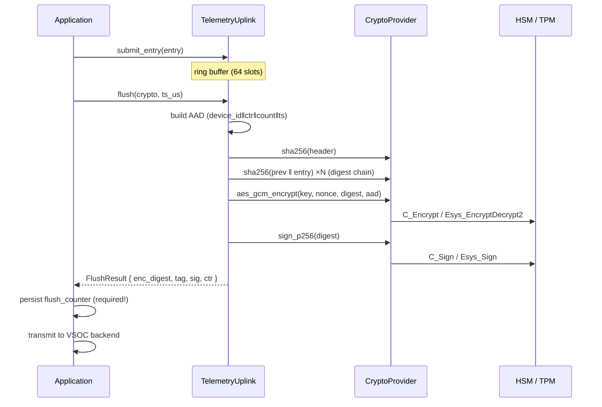

# Architecture

Craton Shield Enterprise extends the [Craton Shield](https://github.com/craton-co/craton-shield) open-source security runtime with production-hardening, hardware crypto backends, and compliance automation.

## Repository Structure

```
craton-shield-enterprise/
  crates/
    crypto-pkcs11/     # PKCS#11 HSM-backed CryptoProvider
    crypto-tpm/        # TPM 2.0 TSS2 ESAPI-backed CryptoProvider
    hal-qnx/           # QNX Neutrino RTOS hardware abstraction
    vsoc-telemetry/    # VSOC telemetry uplink (encrypted batches)
  docs/                # Porting guide, API stability, feature flags
  examples/            # Integration examples
  fuzz/                # Fuzz targets (cargo-fuzz / libFuzzer)
  scripts/             # Build and CI helper scripts
  autosar/             # AUTOSAR Adaptive Platform manifests
```

## Crate Dependency Graph

```
vs-crypto-pkcs11  ──> vs-crypto (trait), vs-types
vs-crypto-tpm     ──> vs-crypto (trait), vs-types
vs-hal-qnx        ──> vs-hal (trait), vs-types
vs-vsoc-telemetry  ──> vs-crypto (trait), vs-types
```

## Component Diagram

GitHub renders Mermaid natively:



### Data flow: VSOC telemetry uplink



Compliance report crates (vs-report-iec62443, vs-report-iso21434, vs-report-iec62304) have moved to [Craton Shield Core](https://github.com/craton-co/craton-shield) (Apache-2.0).

All enterprise crates depend on traits defined in the open-source core. The core provides `CryptoProvider`, `HalProvider`, `VsError`, and shared types. Enterprise crates provide production implementations of those traits.

## Design Principles

- **`#![no_std]`**: Every crate compiles without the standard library. No heap allocations.
- **Zero-copy FFI**: Crypto providers accept caller-supplied function pointers rather than linking against C libraries at build time. This keeps crates `no_std` compatible and allows runtime backend selection.
- **Trait-based abstraction**: Enterprise crates implement traits from the core (`CryptoProvider`, `CanBus`, `Timer`, `EthernetPhy`). Application code depends only on the trait, not the concrete backend.
- **Fixed-size buffers**: All data structures use compile-time-known sizes. No `Vec`, `Box`, or `String`.
- **Deny unsafe by default**: The workspace denies `unsafe_code`. Only `crypto-pkcs11` and `crypto-tpm` opt in, and only for C FFI calls.

## Crypto Provider Architecture

The `CryptoProvider` trait (defined in `vs-crypto` in the core repo) is the central abstraction:

```
                  CryptoProvider (trait)
                  /        |         \
         Pkcs11Provider  TpmProvider  MockProvider
         (enterprise)    (enterprise)  (core, dev-only)
```

Each provider implements: `aes_gcm_encrypt`, `aes_gcm_decrypt`, `sha256`, `hmac_sha256`, `ecdh_derive_shared`, `sign_p256`, `verify_p256`, `random_bytes`, `self_test`.

The PKCS#11 provider forwards to any PKCS#11 v2.40+ HSM. The TPM provider uses AES-CFB + HMAC-SHA-256 Encrypt-then-MAC since TPM 2.0 lacks native AES-GCM.

## Compliance Report Architecture

The `vs-report-iec62443`, `vs-report-iso21434`, and `vs-report-iec62304`
generators now live in [Craton Shield Core](https://github.com/craton-co/craton-shield)
(Apache-2.0). See that repo's architecture documentation for details.

## Licensing Boundary

The core repo (`craton-shield`) is Apache-2.0. This enterprise repo is BSL-1.1 (converts to Apache-2.0 on 2030-09-01). The boundary is at the trait level: traits are free, production implementations are enterprise.
